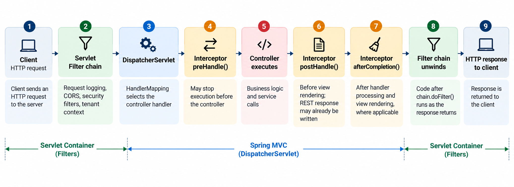

# Output

````
.   ____          _            __ _ _
/\\ / ___'_ __ _ _(_)_ __  __ _ \ \ \ \
( ( )\___ | '_ | '_| | '_ \/ _` | \ \ \ \
\\/  ___)| |_)| | | | | || (_| |  ) ) ) )
'  |____| .__|_| |_|_| |_\__, | / / / /
=========|_|==============|___/=/_/_/_/

:: Spring Boot ::                (v4.1.2)

2026-10-24T02:43:42.003+05:30  INFO 32738 --- [springsecurity] [           main] c.l.s.SpringsecurityApplication          : Starting SpringsecurityApplication using Java 21.0.12.1 with PID 32738 (/Users/modin/Downloads/springsecurity/target/classes started by modin in /Users/modin/Downloads/springsecurity)
2026-10-24T02:43:42.005+05:30  INFO 32738 --- [springsecurity] [           main] c.l.s.SpringsecurityApplication          : No active profile set, falling back to 1 default profile: "default"
2026-10-24T02:43:42.376+05:30  INFO 32738 --- [springsecurity] [           main] o.s.boot.tomcat.TomcatWebServer          : Tomcat initialized with port 8080 (http)
2026-10-24T02:43:42.383+05:30  INFO 32738 --- [springsecurity] [           main] o.apache.catalina.core.StandardService   : Starting service [Tomcat]
2026-10-24T02:43:42.383+05:30  INFO 32738 --- [springsecurity] [           main] o.apache.catalina.core.StandardEngine    : Starting Servlet engine: [Apache Tomcat/11.0.27]
2026-10-24T02:43:42.402+05:30  INFO 32738 --- [springsecurity] [           main] b.w.c.s.WebApplicationContextInitializer : Root WebApplicationContext: initialization completed in 370 ms
2026-10-24T02:43:42.559+05:30  INFO 32738 --- [springsecurity] [           main] o.s.boot.tomcat.TomcatWebServer          : Tomcat started on port 8080 (http) with context path '/'
2026-10-24T02:43:42.561+05:30  INFO 32738 --- [springsecurity] [           main] c.l.s.SpringsecurityApplication          : Started SpringsecurityApplication in 0.762 seconds (process running for 0.952)
2026-10-24T02:43:52.384+05:30  INFO 32738 --- [springsecurity] [nio-8080-exec-1] o.a.c.c.C.[Tomcat].[localhost].[/]       : Initializing Spring DispatcherServlet 'dispatcherServlet'
2026-10-24T02:43:52.385+05:30  INFO 32738 --- [springsecurity] [nio-8080-exec-1] o.s.web.servlet.DispatcherServlet        : Initializing Servlet 'dispatcherServlet'
2026-10-24T02:43:52.386+05:30  INFO 32738 --- [springsecurity] [nio-8080-exec-1] o.s.web.servlet.DispatcherServlet        : Completed initialization in 1 ms
2026-10-24T02:43:52.389+05:30  INFO 32738 --- [springsecurity] [nio-8080-exec-1] c.l.s.filters.MyCustomFilter             : Request with URL: http://localhost:8080/ came at filter at :Sat Oct 24 02:43:52 IST 2026
2026-10-24T02:43:52.396+05:30  INFO 32738 --- [springsecurity] [nio-8080-exec-1] c.l.s.interceptors.MyCustomInterceptor   : Request with URL: http://localhost:8080/ came to interceptor (preHandle) layer at Sat Oct 24 02:43:52 IST 2026
2026-10-24T02:43:52.396+05:30  INFO 32738 --- [springsecurity] [nio-8080-exec-1] c.l.s.interceptors.MyCustomInterceptor   : Logging response status just before controller method invocation, status: 200
2026-10-24T02:43:52.410+05:30  INFO 32738 --- [springsecurity] [nio-8080-exec-1] c.l.s.interceptors.MyCustomInterceptor   : Request with URL: http://localhost:8080/ came to interceptor (postHandle) layer at Sat Oct 24 02:43:52 IST 2026
2026-10-24T02:43:52.410+05:30  INFO 32738 --- [springsecurity] [nio-8080-exec-1] c.l.s.interceptors.MyCustomInterceptor   : Request with URL: http://localhost:8080/ came to interceptor (afterCompletion) layer at Sat Oct 24 02:43:52 IST 2026

````

## 1. Filter

- A Filter is responsible for intercepting HTTP requests at the initial level, before they reach the DispatcherServlet.
Think of it as an entry gate pass checker, where some basic checks and common operations can be performed before the request enters the Spring MVC flow.

### Where is it used?

- Authentication checks using Spring Security filters: whether the user is authenticated or not.
- CORS processing and validations.
- Setting the TenantContext in a multi-tenant architecture: based on the request URL or domain, we identify the tenant, fetch the required details and set the tenant context for the current request.
- Logging each and every API request with traceId, request time, response status and execution time.
- Other common operations which need to be performed at the HTTP request/response level.

## 2. Interceptor

- As the name suggests, an Interceptor intercepts the request during the Spring MVC request processing flow.
Basically, after the DispatcherServlet identifies the handler (controller method), the request goes through the Interceptor's preHandle() method before reaching the controller.

### Where is it used?

- Additional permission checks based on the requested resource or handler.

- Modifying the ModelAndView before the view is rendered using postHandle().

- Performing cleanup or other operations after request processing using afterCompletion().

- One important thing to understand: Spring Security should generally be used for authentication and authorization enforcement rather than relying on MVC Interceptors as the primary security layer.

_Also, if you want to modify REST API response bodies, postHandle() is generally not the right place because the response body may already be written. For such cases, we can use ResponseBodyAdvice._

## 3. Now, let's understand where exactly these fit in the request workflow.




_Note: This is a simplified flow. Exception handling and REST API responses can change some of these execution details._

## 4. Questions ?
- What happens if `preHandle()` returns false ?
  - Request does not proceed and reach to the controller

- Can we have multiple Filter and Interceptors ? 
  - Yes, order needs to be maintained as per the requirement

- Can't we do the interceptor type work in filter layer ? 
  - Yes we can, it more depends on how you want to manage it also generally the interceptors are used to specific endpoints which needs extra access checks
  - for eg. there are 4 endpoints which needs a permission check, then inceptor should be used as blocking each request on filter layer would not be good approach in this case and dispatcher servlet already maps the endpoint so interceptor becomes the right place